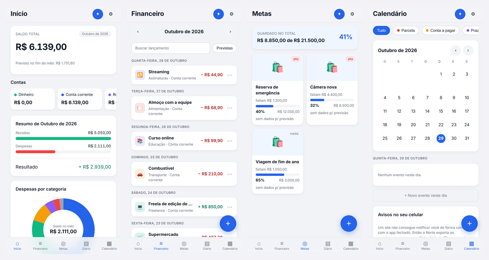

# Norte

App de finanças pessoais que roda no navegador e instala na tela de início do iPhone.

**Contas e lançamentos · compras parceladas · metas de compra com aportes · diário · calendário · assistente de IA**

**[Abrir o app →](https://joaolucasralmeida.github.io/norte-app/)**



<sub>Telas com dados de exemplo.</sub>

Funciona **offline**, com os dados no próprio aparelho. Quem quiser pode entrar
com uma conta e sincronizar entre aparelhos (Supabase, com isolamento total
entre contas por RLS).

> Construído com o [Claude Code](https://claude.com/claude-code) como par de
> programação: eu defini o produto e as regras, revisei cada entrega, e o
> agente implementou.

---

## Instalar no iPhone

1. Abra o endereço deste site **no Safari**.
2. Toque em **Compartilhar** (quadrado com seta para cima).
3. **Adicionar à Tela de Início** → **Adicionar**.

Abrindo pelo ícone, o app ocupa a tela inteira, sem a barra do Safari, e funciona sem internet.

> Se aparecer a barra de endereço ao abrir pelo ícone, foi criado um atalho comum. Apague e repita a partir do Safari — Chrome e outros navegadores no iOS não instalam web apps.

---

## Lembretes de parcela

Um site não consegue notificar de forma confiável com o app fechado. Em vez de tentar, o Norte entrega os vencimentos ao **app Calendário do iPhone**, que é quem dispara os alertas — no horário certo e de graça.

Aba **Calendário** → **Enviar eventos para o Calendário** → escolha "Calendário" na folha de compartilhamento.

Reimportar não duplica: cada evento tem identificador fixo, então o Calendário atualiza o que já existe.

---

## Assistente de IA

Chat para pesquisar preços antes de uma compra. Roda num Cloudflare Worker
que faz o **loop de chamada de ferramentas com o Gemini** e busca na web pela
Tavily. A resposta chega por streaming (SSE), com as fontes citadas.

- As chaves do Gemini e da Tavily ficam só no Worker. O app manda apenas a pergunta.
- O que o modelo devolve é tratado como **não confiável**: links e imagens passam
  por `safeURL`, que só aceita `https:`. Uma página lida pelo modelo poderia
  conter uma instrução para gerar um link `javascript:` (injeção de prompt).
- Sem o servidor, a tela explica o que falta e o resto do app segue offline.

---

## Para desenvolvedores

Sem build, sem npm, sem dependências: HTML, CSS e JavaScript que o navegador lê direto. Para testar localmente, sirva a pasta por HTTP — abrir o `index.html` com duplo clique não funciona, porque `file://` bloqueia módulos e service worker.

```
index.html              casca e barra de abas
manifest.webmanifest    nome, ícone, modo tela cheia
sw.js                   cache offline
css/app.css             estilo, claro e escuro
js/domain.js            parcelamento, saldos e metas (funções puras)
js/db.js                IndexedDB
js/store.js             estado e escrita
js/ics.js               geração do arquivo de calendário
js/cloud/               login, sincronização e convites (Supabase)
js/screens/chat.js      cliente do assistente de IA (SSE)
js/screens/             uma tela por arquivo
```

Publicou uma atualização e o app continua antigo? Feche-o na multitarefa e abra de novo, ou incremente `VERSION` em `sw.js`.
